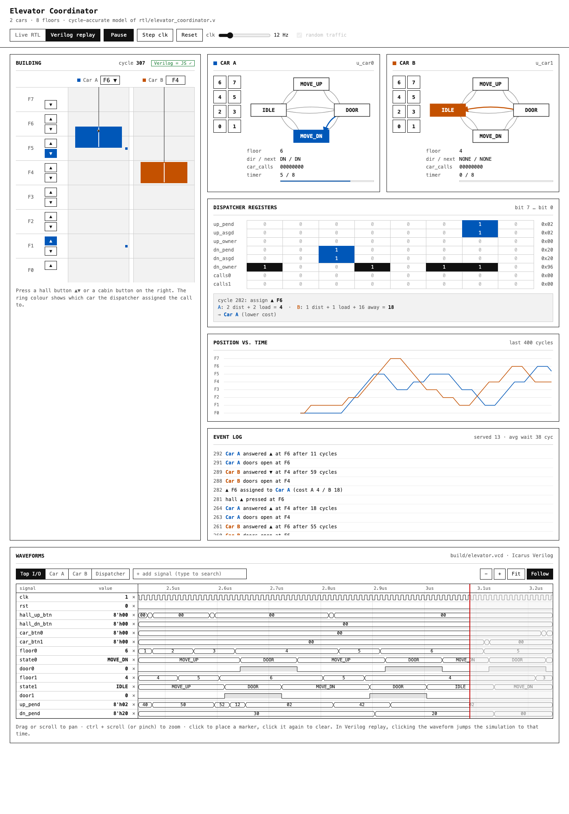

# Elevator Coordinator: DSCO project

A Verilog RTL design of a **2-car, 8-floor elevator system** with a central
hall-call dispatcher, plus an animated website. The website runs a
cycle-accurate model of the same RTL and can replay the Icarus Verilog
simulation trace.



## Report

The full project report covers the design, every digital-electronics concept used, verification, results and sustainability.

- [docs/REPORT.md](docs/REPORT.md): readable on GitHub
- [docs/REPORT.pdf](docs/REPORT.pdf): for printing or submission

## Run it

```sh
./run.sh            # stimulus → iverilog sim → self-checks → JS-vs-Verilog cross-check
open web/index.html # the website (works straight from the file system)
```

`./run.sh 8000 42` sets the simulation to 8000 cycles with random seed 42.
Waveforms are written to `build/elevator.vcd`; open them with GTKWave.

## Files

| Path | What it is |
|---|---|
| `rtl/elevator_car.v` | One car: FSM + floor register, tick timer, cabin-call register |
| `rtl/hall_call_dispatcher.v` | The coordinator: latches hall calls and assigns each to the cheapest car |
| `rtl/elevator_coordinator.v` | Top level: dispatcher + 2 cars |
| `tb/tb_elevator_coordinator.v` | Testbench: stimulus from file, trace + VCD, safety and liveness checks |
| `scripts/gen_stimulus.js` | Seeded random button presses → `build/stim.hex` |
| `scripts/verify.js` | Runs the JS model on the same stimulus and compares every register every cycle |
| `scripts/vcd2js.js` | Converts `build/elevator.vcd` for the website and checks every internal net of the JS model against it |
| `web/elevator_rtl.js` | JS port of the RTL (1:1 with the Verilog equations) |
| `web/waves.js` | GTKWave-style waveform viewer |
| `web/sound.js` | Button beeps, door chime, music while the cars move |
| `docs/` | Project report (Markdown + PDF) and images |
| `web/index.html`, `app.js`, `style.css` | The visualisation |

## Design

**Car FSM** (`elevator_car.v`), 1 clock = 1 tick:

| State | Behaviour |
|---|---|
| `IDLE` | Opens the door if there is a request at this floor; otherwise starts moving toward requests |
| `MOVE_UP` / `MOVE_DN` | Takes `TRAVEL_TICKS` (8) per floor; at each floor checks whether to stop |
| `DOOR` | Stays open `DOOR_TICKS` (10); the timer restarts if a new call is answered at this floor |

The cars use **SCAN**: a car keeps its direction while there is still work
ahead (`next_dir`). It stops for a cabin call, for a hall call in its
direction of travel, or for any hall call when nothing is left beyond it.

**Dispatcher** (`hall_call_dispatcher.v`):

- Hall calls are held in `*_pend` registers.
- Each cycle a priority encoder picks one unassigned call and assigns it to the cheaper car:

  `cost = |car floor − call floor| + load + (car heading away ? 2N : 0)`

  `load` is the number of stops the car already has. Ties go to car A.
- `*_asgd` and `*_owner` record the assignment. A car's `serve_up` / `serve_dn` strobes clear the call.

## Verification

- **Testbench checks:** a door is never open outside `DOOR`, floors stay in range, and no hall call waits more than 600 cycles (starvation check).
- **Co-simulation:**
  - `scripts/verify.js` steps the JS model on the same stimulus and compares all 16 registers on every cycle against the Verilog trace. Replay mode in the website repeats this check live (the "Verilog = JS ✓" badge).
  - `scripts/vcd2js.js` does the same for 145 named signals in the VCD, including combinational nets such as `next_dir`, `stop_up`, `cost0` and `pick_floor`.

## Website

- **Live RTL:** click hall ▲▼ or cabin buttons, or let random traffic run.
- **Verilog replay:** plays back `build/trace_verilog.txt`. Open `web/index.html#replay@1200` to jump to cycle 1200.
- **Views:** FSM diagrams with the last transition highlighted, dispatcher register bits, the cost breakdown for each assignment, a position-vs-time chart, and an event log.
- **Waveforms:** a GTKWave-style viewer under the animation.
  - In replay mode it shows the real `build/elevator.vcd`; in live mode it records the same signals, with the same names, from the JS model.
  - Presets: Top I/O, Car A, Car B, Dispatcher. Type in the search box to add any other signal.
  - Drag or scroll to pan, ctrl + scroll to zoom, click to place a marker. In replay mode, a click jumps the simulation to that time.
- **Sound** (toggle in the header):
  - a beep on every button press and a chime when doors open
  - music that fades in while any car is moving
  - for the music, the track at `web/songbird.mp3` plays (swap in your own file to change it), or click **♪ music** in the header to pick a song file in the browser; the page remembers it (shift-click to clear). Without either, an original synthesized lounge loop plays
- **Keys:** Space runs or pauses; `s` or → steps one clock.
