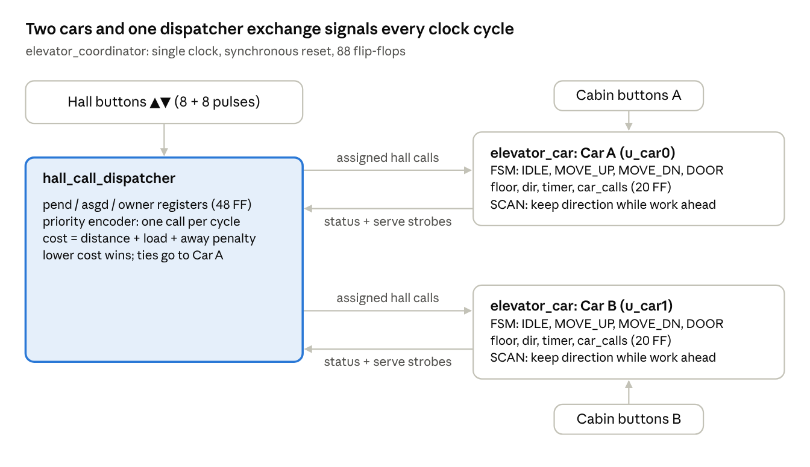
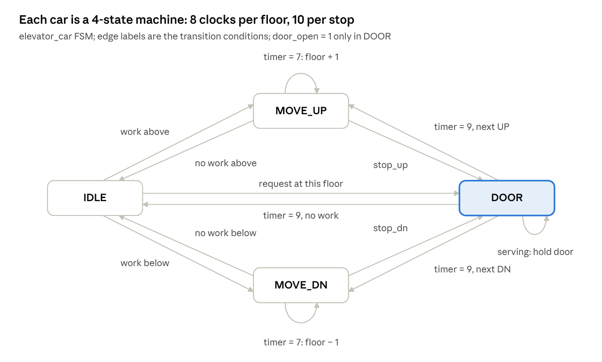

# Elevator Coordinator: DSCO Project Report

Oct 19, 2026 · Satvik

## Abstract

This project implements a two-car, eight-floor elevator coordinator as synchronous digital hardware in Verilog, verifies it in simulation, and visualises it on an interactive website that is driven by a cycle-accurate model of the same logic.

The design has three modules:

- **`elevator_car`** (two instances): a finite state machine with a small datapath that moves one car between floors.
- **`hall_call_dispatcher`**: the coordinator. It stores the up/down buttons pressed on each floor and assigns each call to the car with the lowest cost.
- **`elevator_coordinator`**: the top level that connects them.

The whole system uses 88 flip-flops and runs on a single clock.

Verification combines a self-checking testbench (safety and starvation checks) with co-simulation. A JavaScript model of the RTL is compared against the Icarus Verilog output on every register (16 values) and on 145 named internal signals, on every clock cycle. Both match exactly across 4,000-cycle runs on five random seeds.

Verification caught a real starvation bug, where a call could go unanswered indefinitely. After the fix, every run serves all hall calls, 184 to 211 per run, with a longest wait of at most 246 clock cycles. The website animates the building, the state machines, the dispatcher's registers and its decisions. It also includes a waveform viewer that shows the real VCD dump from the Verilog simulation.

## 1. Introduction and objectives

A building with several elevators needs a coordinator, a controller that decides which car answers each button press on a landing. A good coordinator keeps waiting times short and never leaves a passenger stranded. It also avoids sending two cars to the same call.

This is a natural digital-systems problem. Button presses are asynchronous events that must be captured and remembered. Each car is a machine that moves through well-defined states. The assignment decision is a piece of combinational arithmetic evaluated every clock cycle.

### 1.1 Problem statement

Design, in synthesizable Verilog, a controller for **2 elevator cars serving 8 floors (F0 to F7)** that:

1. Accepts **hall calls**, the ▲/▼ buttons on each landing, and **cabin calls**, the floor buttons inside each car.
2. Assigns every hall call to exactly one car, using a cost function based on distance, direction and current workload.
3. Moves each car using the SCAN ("elevator") algorithm. A car keeps travelling in one direction while it has requests that way, then reverses.
4. Models travel time and door-open time with counters, so behaviour is realistic in clock cycles.
5. Is **safe**, meaning a door is never open while a car moves, and **live**, meaning every call is eventually answered.

### 1.2 Objectives

- Apply core digital-design building blocks in one coherent system: registers, finite state machines, decoders, priority encoders, comparators, adders and counters.
- Keep the design parameterised: number of floors, travel time and door time.
- Verify the design rigorously:
  - a self-checking testbench
  - randomised stimulus
  - safety and liveness assertions
  - an independent reference model compared on every cycle
- Make the hardware's behaviour visible and explainable through an interactive website, including the real simulation waveforms.
- Relate the project to sustainability: elevators are a significant part of a building's energy use, and good dispatch reduces wasted trips.

### 1.3 Tools

| Tool | Use |
| --- | --- |
| Verilog-2005 | Hardware description of the design and testbench |
| Icarus Verilog 13.0 (`iverilog`, `vvp`) | Compilation and event-driven simulation |
| VCD (Value Change Dump) | Waveform output, viewable in GTKWave or on the website |
| Node.js | Stimulus generation, co-simulation checks, VCD conversion |
| HTML, CSS, JavaScript (no frameworks) | The visualisation website |

## 2. System architecture

The system is three modules in a two-level hierarchy, all clocked by one clock `clk` with a synchronous active-high reset `rst`. The dispatcher owns the hall calls and tells each car which ones are its own. Each car owns its cabin calls and reports its position, state and direction back, plus which calls it served.



Hall buttons go only to the dispatcher. Cabin buttons go straight to their own car. The two cars never talk to each other; all coordination passes through the dispatcher.

### 2.1 Module hierarchy

```
tb_elevator_coordinator          (testbench, not synthesized)
└── elevator_coordinator  dut    (top level)
    ├── hall_call_dispatcher  u_dispatch
    ├── elevator_car          u_car0   (Car A)
    └── elevator_car          u_car1   (Car B)
```

### 2.2 Parameters

| Parameter | Value | Meaning |
| --- | --- | --- |
| `N` | 8 | Number of floors; every request vector is N bits wide, one bit per floor |
| `FW` | 3 | Floor-index width = log₂N |
| `TRAVEL_TICKS` | 8 | Clock cycles to travel one floor |
| `DOOR_TICKS` | 10 | Clock cycles the door stays open |

### 2.3 Top-level interface

| Port | Dir | Width | Description |
| --- | --- | --- | --- |
| `clk`, `rst` | in | 1 each | Clock; synchronous reset |
| `hall_up_btn`, `hall_dn_btn` | in | 8 each | Landing buttons, one-cycle pulses, bit i = floor i |
| `car_btn0`, `car_btn1` | in | 8 each | Cabin buttons of car A / car B, one-cycle pulses |
| `floor0/1` | out | 3 | Last floor each car reached |
| `state0/1` | out | 2 | FSM state (IDLE, MOVE\_UP, MOVE\_DN, DOOR) |
| `dir0/1` | out | 2 | Committed direction (NONE, UP, DN) |
| `timer0/1` | out | 5 | Travel / door tick counter |
| `calls0/1` | out | 8 | Latched cabin calls |
| `door0/1` | out | 1 | Door open |
| `up_pend`, `up_asgd`, `up_owner`, `dn_pend`, `dn_asgd`, `dn_owner` | out | 8 each | Hall-call registers (pending, assigned, which car owns it) |

### 2.4 Signals between the modules

- **Dispatcher → car i:** `hall_up_asg`, `hall_dn_asg` (8 bits each) are the hall calls assigned to that car.
- **Car i → dispatcher:**
  - status: `floor`, `state`, `dir`, `next_dir`, `car_calls`, used by the cost function
  - `serve_up`, `serve_dn`: strobes that clear a hall call when the car answers it

### 2.5 Storage (flip-flop count)

| Block | Registers | Flip-flops |
| --- | --- | --- |
| Each car | floor 3 + state 2 + dir 2 + timer 5 + car\_calls 8 | 20 (× 2 = 40) |
| Dispatcher | 6 registers × 8 bits | 48 |
| **Total** |  | **88** |

Everything else is combinational logic between these 88 flip-flops.

## 3. Digital electronics concepts used

Every concept below appears in the actual design. Each entry gives a short explanation, the hardware it becomes, and where to find it in the code.

### 3.1 Number representation and encoding

**Binary and hexadecimal.** All values are unsigned binary. Floors use 3 bits (0 to 7), the timer 5 bits (0 to 31), and costs 6 bits (0 to 63). 8-bit vectors are written in hex, so `8'h3c` = `0011_1100`.

**Bit vectors as sets.** Every request is an 8-bit vector with **one bit per floor**. Bit i = 1 means "there is a request at floor i". This turns set operations into single gates applied to all eight bits in parallel:

| Set operation | Verilog | Hardware |
| --- | --- | --- |
| Union | `car_calls \| hall_up_asg \| hall_dn_asg` | 8 three-input OR gates |
| Intersection | `targets & mask_above` | 8 AND gates |
| Remove an element | `pend & ~served` | 8 AND gates with inverted inputs |
| Is the set non-empty? | `\|(targets & mask_above)` | an 8-input OR (reduction) |

**One-hot encoding.** `here` is one-hot: exactly one bit is 1, the bit for the car's current floor (`floor = 3` gives `here = 0000_1000`). One-hot vectors let the design test "is there a request *at this floor*" with one AND and an OR reduction.

**Binary (encoded) state assignment.** The four FSM states use a 2-bit binary encoding (`IDLE = 00`, `MOVE_UP = 01`, `MOVE_DN = 10`, `DOOR = 11`). That needs 2 flip-flops instead of the 4 a one-hot state register would use. Directions use the same idea (`NONE = 00`, `UP = 01`, `DN = 10`).

### 3.2 Combinational building blocks

Combinational logic has outputs that depend only on the current inputs, with no memory. It is written with `assign` statements and `always @*` blocks.

**Logic gates and Boolean algebra.** The stop conditions are plain sum-of-products expressions. For example:

```verilog
stop_up = |(here & (car_calls | hall_up_asg)) | (|(here & hall_dn_asg) & ~any_above);
```

In words: stop when going up if there is a cabin call or an up call here. Also stop for a down call here, but only if nothing is left above.

**Reduction operators.** `|vector` ORs all bits together, which becomes a tree of OR gates. It is used for `any_above`, `any_below`, `any_here` and `serving`.

**Decoder (3-to-8).** `here = 8'b1 << floor` turns a 3-bit binary floor number into a one-hot 8-bit vector. That is exactly a 3-to-8 line decoder. The dispatcher uses the same structure for `pick_vec = 1 << pick_floor`.

**Masks using two's-complement arithmetic.** Subtracting 1 from a one-hot vector sets every lower bit, which gives a "floors below me" mask with no loop:

```verilog
mask_below = here - 1;               // here = 0000_1000  ->  mask_below = 0000_0111
mask_above = ~(mask_below | here);   //                       mask_above = 1111_0000
```

The subtractor is a borrow chain. The above-mask is then just OR and NOT.

**Multiplexers.** Every `? :` and every `case` / `if` that picks a value becomes a multiplexer:

- `next_dir` is a 4-way priority mux.
- The cost penalty `en_route ? 0 : 2N` is a 2:1 mux.
- `serve_up` is gated by `in_door && next_dir != DN`, which acts as an AND-gate enable.

**Priority encoder.** The dispatcher has to choose one call to assign per clock out of up to 14 pending, unassigned calls. Two `for` loops scan the floors and keep the lowest-numbered UP call, otherwise the lowest-numbered DOWN call. Synthesis unrolls the loops into a fixed-priority encoder that outputs `pick_valid`, `pick_up` and `pick_floor`. This is the same circuit used in interrupt controllers and bus arbiters.

**Magnitude comparators.**

- `cf > f`, `f < cf` and `cost1 < cost0` are magnitude comparators. In gates they are a subtractor whose borrow output is the result.
- `timer == TRAVEL_TICKS - 1` and `state == S_DOOR` are equality comparators: XNOR each bit pair, then AND the results.

**Adders and subtractors.** `floor + 1`, `floor - 1` and `timer + 1` are incrementers and decrementers, built as ripple-carry adders. The cost `dist + load + penalty` is a 6-bit three-operand adder.

**Absolute difference.** `dist = (cf > f) ? cf - f : f - cf` uses a comparator, two subtractors and a 2:1 mux. Together they compute |a − b| without signed arithmetic.

**Population count (popcount).** `load` counts the 1 bits in an 8-bit vector, the number of floors a car must stop at. The Verilog `function popcount` adds the bits in a loop. Synthesis turns it into an adder tree that produces a 4-bit count from 0 to 8.

### 3.3 Sequential building blocks

Sequential logic has outputs that depend on stored state. It is written in `always @(posedge clk)` blocks.

**Clock and edge-triggered D flip-flops.** All 88 storage bits are D flip-flops that sample their input on the rising edge of `clk`. Between edges the stored value is stable, and the combinational logic computes the next value. The testbench clock has a 10 ns period (`always #5 clk = ~clk`).

**Registers.** Groups of flip-flops loaded together: `floor[2:0]`, `state[1:0]`, `dir[1:0]`, `timer[4:0]`, `car_calls[7:0]`, and the six dispatcher registers.

**Synchronous reset.** `if (rst) ...` is inside the clocked block, so reset takes effect only on a clock edge. This avoids reset glitches and is the usual style for FPGA designs.

**Set/clear registers that latch pulses.** Buttons produce one-cycle pulses, but a request must be remembered until it is served. Each request register uses the same pattern:

```verilog
up_pend <= (up_pend | hall_up_btn) & ~served_up;   // set on press, clear when served
```

Each bit behaves like an SR latch built from a D flip-flop. Set is the button, Reset is the serve strobe, and the hold path feeds the output back to the input.

**Counters.**

- `timer` is a modulo counter with synchronous clear. It counts 0 to 7 while travelling (`TRAVEL_TICKS`) and 0 to 9 while the door is open (`DOOR_TICKS`), then clears and triggers an event.
- `floor` is an up/down counter. It increments or decrements once each time the timer wraps.
- In the door state the timer also has a **restart** input. If a new passenger is served while the door is open, `serving` clears the timer so the door stays open longer.

### 3.4 Finite state machines

A finite state machine (FSM) is a state register, next-state logic and output logic. Each car is an FSM with 4 states, described fully in section 4.

- **Moore outputs** depend only on the state. `door_open = (state == DOOR)` is a Moore output, so it is glitch-free and changes only on clock edges.
- **Mealy outputs** depend on the state *and* the current inputs. `serve_up`, `serve_dn` and `serving` are Mealy-style, because they also depend on the hall-call assignments and the cabin buttons pressed this cycle.
- **Datapath and control split.** The FSM (control) decides *what* to do: move, stop, open. The datapath (floor counter, timer, request registers, comparators) does the arithmetic and storage. Control signals such as "increment floor" and "clear timer" go from the FSM to the datapath. Status signals such as `timer == 7`, `any_above` and `stop_up` go back.

### 3.5 Synchronous design and timing

- **Single clock domain.** Every flip-flop uses the same `clk`, so there is no clock-domain crossing.
- **No combinational loops.** The car's `serve_up` depends on `hall_up_asg`, which comes from *registered* dispatcher state. The dispatcher's next state depends on `serve_up`. That path goes through flip-flops, so it is legal, and the circuit has no combinational feedback.
- **Critical path.** The longest combinational path is: request registers → OR → popcount adder tree → three-operand cost adder → cost comparator → owner mux → `up_owner` register. That path limits the maximum clock frequency.
- **Setup and hold.** In real hardware, each flip-flop input must be stable shortly before (setup) and after (hold) the clock edge. The testbench changes inputs 1 ns after each edge, safely away from the next one.
- **Blocking versus non-blocking assignment.** Clocked blocks use `<=` (non-blocking). Every register reads its *old* value and all registers update together at the edge, which matches real flip-flops and avoids simulation races. Combinational blocks (`always @*`) use `=` (blocking).

### 3.6 Arbitration, scheduling and fairness

- **Arbitration.** When several calls are waiting, the priority encoder grants one per cycle. Fixed priority is safe here because a granted call stops competing immediately (its `asgd` bit is set). At most 14 calls can be waiting (7 up, 7 down), so a new call is normally assigned within a few cycles of being pressed.
- **Cost-based scheduling.** The dispatcher assigns each call to the car with the lowest cost: distance plus workload plus a penalty if the car is heading away. Ties go to car A, so the result is deterministic.
- **SCAN algorithm.** Each car keeps its direction while there is demand ahead (`want_up` / `want_dn`), like a disk-arm scheduler. This bounds how long any request can wait.
- **Starvation and liveness.** A design can be safe yet never serve some request. Section 7 describes a starvation bug found by a liveness check and how the direction logic was corrected.

### 3.7 Hardware description language (Verilog) concepts

| Concept | Where it is used |
| --- | --- |
| `module`, ports, hierarchy, instantiation | Three modules; the top instantiates the dispatcher and two cars |
| `parameter` / `localparam` and overriding with `#(...)` | `N`, `FW`, `TRAVEL_TICKS`, `DOOR_TICKS`; state and direction codes |
| `wire` and `assign` (continuous assignment) | All decode, mask and serve logic |
| `reg` in `always @(posedge clk)` | All registers |
| `always @*` with `for` loops | Priority encoder; loops are unrolled into parallel hardware, not run in time |
| `function` | `popcount` and `cost`; each becomes one copy of combinational logic per call |
| Replication and concatenation `{N{1'b0}}`, `{a,b}` | Zero vectors; unpacking the 32-bit stimulus word |
| Bit-width handling and truncation | Costs kept in 6 bits, timer in 5, floor in 3 |
| `` `timescale `` | 1 ns / 1 ps simulation time units |

### 3.8 Verification concepts

Section 6 covers these in detail.

- **Testbench:** a non-synthesizable module that drives the design and checks its outputs.
- **File-driven stimulus:** `$readmemh` loads one 32-bit word per cycle.
- **Randomised testing with seeds:** reproducible random traffic.
- **Assertions:** safety properties ("never X") and liveness properties ("eventually Y").
- **Golden reference model and co-simulation:** an independent model is compared with the RTL on every cycle.
- **VCD waveform dump:** `$dumpfile` / `$dumpvars` record every signal change for waveform viewing.

## 4. Module design: `elevator_car`

Each car is a 4-state machine plus a datapath of five registers. It moves one floor every 8 clock cycles and holds its door open for 10 cycles. It answers its cabin calls and the hall calls the dispatcher assigned to it, in SCAN order.



DOOR is the only state with the door open. Every path from a MOVE state to another MOVE state passes through DOOR or IDLE, so the car never reverses mid-floor.

### 4.1 Registers (datapath)

| Register | Width | Role |
| --- | --- | --- |
| `state` | 2 | Current FSM state |
| `floor` | 3 | Last floor reached (up/down counter) |
| `dir` | 2 | Committed direction of travel |
| `timer` | 5 | Ticks spent travelling the current floor, or with the door open |
| `car_calls` | 8 | Latched cabin buttons, one bit per floor |

### 4.2 Combinational signals

| Signal | Definition | Meaning |
| --- | --- | --- |
| `here` | `1 << floor` | One-hot current floor (decoder) |
| `targets` | `car_calls \| hall_up_asg \| hall_dn_asg` | Every floor this car must stop at |
| `mask_below`, `mask_above` | `here − 1`, `~(mask_below \| here)` | Floors below / above the car |
| `any_above`, `any_below`, `any_here` | OR-reduction of `targets` & mask | Is there work above / below / here? |
| `want_up` | `any_above \| (hall_up_asg & here ≠ 0)` | Demand in the up direction |
| `want_dn` | `any_below \| (hall_dn_asg & here ≠ 0)` | Demand in the down direction |
| `next_dir` | priority mux, below | Direction the car will take next |
| `stop_up`, `stop_dn` | sum-of-products, below | Should the car stop at this floor? |
| `serve_up`, `serve_dn`, `serve_car`, `serving` | gated by `state == DOOR` | Which calls this stop answers |

### 4.3 Direction logic (SCAN)

`next_dir` is a priority multiplexer. The first true row wins:

| Priority | Condition | `next_dir` |
| --- | --- | --- |
| 1 | `dir == UP` and `want_up` | UP (keep going up) |
| 2 | `dir == DN` and `want_dn` | DN (keep going down) |
| 3 | `want_up` | UP |
| 4 | `want_dn` | DN |
| 5 | otherwise | NONE |

Rows 1 and 2 are what make this SCAN rather than "go to the nearest call". A car finishes its sweep before reversing, so a request cannot be postponed forever by newer requests on the other side.

### 4.4 Stop logic

When the car reaches a floor (`timer == 0` in a MOVE state), it stops if:

- **Moving up:** there is a cabin call or an assigned UP call here; **or** there is an assigned DOWN call here and nothing left above (the car turns around here).
- **Moving down:** the mirror image.

If it does not stop and has no work further on, it goes IDLE.

### 4.5 State transition table

| Current state | Condition (first match wins) | Next state | Datapath action |
| --- | --- | --- | --- |
| IDLE | `any_here` | DOOR | timer ← 0 |
| IDLE | `any_above` | MOVE\_UP | dir ← UP |
| IDLE | `any_below` | MOVE\_DN | dir ← DN |
| IDLE | otherwise | IDLE | dir ← NONE |
| MOVE\_UP | `timer == 0` and `stop_up` | DOOR |  |
| MOVE\_UP | `timer == 0` and not `any_above` | IDLE | dir ← NONE |
| MOVE\_UP | `timer == 7` | MOVE\_UP | floor ← floor + 1, timer ← 0 |
| MOVE\_UP | otherwise | MOVE\_UP | timer ← timer + 1 |
| MOVE\_DN | (mirror of MOVE\_UP, using `stop_dn`, `any_below`, floor − 1) |  |  |
| DOOR | `serving` (someone new boarded) | DOOR | timer ← 0 (hold door) |
| DOOR | `timer == 9` and `next_dir == UP` | MOVE\_UP | dir ← UP, timer ← 0 |
| DOOR | `timer == 9` and `next_dir == DN` | MOVE\_DN | dir ← DN, timer ← 0 |
| DOOR | `timer == 9` and `next_dir == NONE` | IDLE | dir ← NONE, timer ← 0 |
| DOOR | otherwise | DOOR | timer ← timer + 1 |

In every state, `car_calls ← (car_calls | car_btn) & ~(DOOR ? here : 0)`. A cabin button is latched immediately, and the call for the current floor clears while the door is open.

### 4.6 Serving calls

While the door is open:

- The cabin call for this floor is cleared.
- A hall **UP** call here is answered only if the car will not leave downward (`next_dir != DN`). A hall **DOWN** call is answered only if it will not leave upward.

A passenger waiting to go up is therefore never "served" by a car that is about to go down. The serve strobes go to the dispatcher, which clears the call on the next clock edge.

### 4.7 Why safety holds by construction

- `door_open` is a Moore output equal to `state == DOOR`.
- The `floor` register only changes in the MOVE states.
- A door therefore can never be open while the car moves. The testbench still checks this on every cycle.

## 5. Module design: `hall_call_dispatcher`

The dispatcher is the coordinator. It stores every hall call in three 8-bit registers per direction and assigns one unassigned call per clock cycle to the car with the lower cost.

### 5.1 Call registers

| Register | Bit i means | Set when | Cleared when |
| --- | --- | --- | --- |
| `up_pend` / `dn_pend` | A passenger is waiting at floor i | Button pressed | A car serves it (`serve_up0 \| serve_up1`) |
| `up_asgd` / `dn_asgd` | The call has been given to a car | The priority encoder picks it | Served |
| `up_owner` / `dn_owner` | Which car owns it (0 = A, 1 = B) | Written at assignment | Not cleared; only meaningful while `asgd` = 1 |

The vectors each car receives are pure AND logic on these registers:

```verilog
up_asg0 = up_pend & up_asgd & ~up_owner;   // car A's up calls
up_asg1 = up_pend & up_asgd &  up_owner;   // car B's up calls
```

### 5.2 Choosing which call to assign (priority encoder)

An unassigned call is `pend & ~asgd`. The encoder grants the lowest-numbered unassigned UP call; if there is none, the lowest-numbered unassigned DOWN call. Its outputs are `pick_valid`, `pick_up` (direction) and `pick_floor` (3-bit index). A 3-to-8 decoder turns `pick_floor` back into the one-hot `pick_vec`, which sets the right `asgd` bit.

### 5.3 Cost function

For the picked call, both cars' costs are computed in parallel. That is two copies of the same combinational circuit:

```latex
\text{cost} = |\,\text{car floor} - \text{call floor}\,| + \text{load} + \begin{cases} 0 & \text{car is idle or heading toward the call} \\ 2N = 16 & \text{otherwise} \end{cases}
```

- **Distance** comes from the absolute-difference circuit (comparator, subtractors, mux).
- **Load** is the popcount of `car_calls | up_asg | dn_asg`: the number of floors the car already has to stop at.
- **En-route test.** The car's effective direction is `next_dir` if its door is open, otherwise `dir`. The car counts as heading toward the call if either:
  - it has no direction (idle), or
  - it is going the call's way and the call is ahead of it, or at its floor with the door open.

Then `pick_car1 = (cost1 < cost0)`. On equal costs car A wins, which keeps the hardware deterministic.

### 5.4 Two real decisions from the simulation

These are taken from the Verilog trace and shown live on the website.

| Cycle | Call | Car A cost | Car B cost | Winner |
| --- | --- | --- | --- | --- |
| 282 | ▲ at F6 | 2 dist + 2 load + 0 = **4** | 1 dist + 1 load + 16 away = 18 | A |
| 1441 | ▲ at F0 | 5 dist + 2 load + 16 away = 23 | 2 dist + 1 load + 16 away = **19** | B |

At cycle 282, car B was one floor closer but moving away, so the penalty sent the call to car A. At cycle 1441 both cars were moving away, so distance and load decided.

### 5.5 Register update (one clock edge)

```verilog
up_pend  <= (up_pend | hall_up_btn) & ~served_up;
up_asgd  <= (up_asgd & ~served_up) | new_up;            // new_up = pick_vec if an UP call was picked
up_owner <= (up_owner & ~new_up) | (pick_car1 ? new_up : 0);
```

The DOWN registers use the same three equations. A call cannot be picked and served in the same cycle: picking needs `asgd = 0` and serving needs `asgd = 1`.

## 6. Integration and timing

The top level `elevator_coordinator` only wires the three modules together. All behaviour comes from the 88 flip-flops updating together on each rising edge of `clk`.

### 6.1 Clock, reset and input timing in the testbench

- `clk` toggles every 5 ns (100 MHz in simulation time). Rising edges fall at 5, 15, 25 ns and so on.
- `rst` is held high for the first two rising edges, so every register is cleared, then released at 16 ns.
- Inputs change 1 ns after each rising edge. They are therefore stable for 9 ns before the next edge, which models the setup-time requirement of real flip-flops.
- Button inputs are one-cycle pulses. The request registers turn them into stored requests.

### 6.2 One clock cycle, step by step

1. **Edge:** every register takes its next value at the same time (non-blocking `<=`).
2. **Settling:** combinational logic recomputes from the new register values: decoders, masks, `targets`, `next_dir`, stop logic, priority encoder, costs and serve strobes.
3. **Inputs arrive:** button pulses change 1 ns after the edge, and the logic settles again.
4. **Next edge:** the next-state values are captured, and the cycle repeats.

### 6.3 Worked example: one passenger, cycle by cycle

Both cars start idle at F0. A passenger presses ▲ at F2, and later presses F5 inside car A. The rows below come from the cycle-accurate model, which matches the Verilog.

| After edge | What changed | Why |
| --- | --- | --- |
| 1 | `up_pend` = 0000\_0100 | The ▲ pulse at F2 is latched by the set/clear register |
| 2 | `up_asgd` bit 2 = 1, owner = A | Priority encoder picks F2; costs A = 2, B = 2, tie goes to A |
| 3 | Car A: IDLE → MOVE\_UP, `dir` = UP | `any_above` is true (F2 is in `targets` and above F0) |
| 4–10 | `timer` 1 → 7 | Travel counter |
| 11 | `floor` = 1, `timer` = 0 | Counter wrapped, so the floor up-counter increments |
| 19 | `floor` = 2, `timer` = 0 | Second floor travelled |
| 20 | MOVE\_UP → DOOR | `timer == 0` and `stop_up` (an assigned ▲ call is `here`) |
| 21 | `up_pend`, `up_asgd` cleared | `serve_up` strobe was high during cycle 20; the door timer restarts |
| 22–30 | Door `timer` 1 → 9 | Door held open for 10 cycles |
| 31 | DOOR → IDLE; `car_calls` = 0010\_0000 | Door timed out with `next_dir` = NONE; the F5 cabin button was latched on the same edge |
| 32 | IDLE → MOVE\_UP | New target above |
| 40 | `floor` = 3 | Travelling toward F5 |

The call took **19 clock cycles** from button press to door opening: 1 to latch, 1 to assign, 1 to start, 16 to travel two floors. Every step is visible in the VCD and on the website's waveform viewer.

## 7. Verification methodology

The design is checked in three independent ways on every run of `./run.sh`:

1. Assertions inside the testbench.
2. A register-by-register comparison against a separate reference model.
3. A signal-by-signal comparison of the VCD waveform against the same model.

All three pass on every seed tested.

### 7.1 The verification flow

1. **Stimulus generation.** `scripts/gen_stimulus.js` produces `build/stim.hex`: one 32-bit word per clock cycle, packed as `{hall_up[7:0], hall_dn[7:0], car_btn0[7:0], car_btn1[7:0]}`.
   - It uses a seeded pseudo-random generator (mulberry32), so any run can be reproduced exactly from its seed.
   - Each cycle: 3.5 % chance of a ▲ call, 3.5 % chance of a ▼ call, 1.5 % chance of a cabin call per car.
   - Impossible calls are never generated: no ▲ at the top floor, no ▼ at the ground floor.
2. **Compile and simulate.** `iverilog -g2005 -Wall` compiles the RTL and testbench, then `vvp` runs 4,000 cycles.
3. **Trace and waveform.** The testbench writes `build/trace_verilog.txt` (all 16 output registers, every cycle) and `build/elevator.vcd`, a full waveform of every signal in the hierarchy.
4. **Co-simulation check.** `scripts/verify.js` runs the JavaScript model on the same stimulus and compares all 16 values on every cycle.
5. **Waveform check.** `scripts/vcd2js.js` parses the VCD, compares 145 named signals against the model, and exports the waveform for the website.

### 7.2 Testbench assertions

| Property | Type | Check | Result |
| --- | --- | --- | --- |
| A door is never open outside the DOOR state | Safety ("something bad never happens") | Every cycle, both cars | Never violated |
| Floor index always within 0–7 | Safety | Every cycle, both cars | Never violated |
| Every hall call is answered within 600 cycles | Liveness ("something good eventually happens") | A per-floor age counter for each direction | Never violated after the fix (section 8) |

At the end the testbench prints how many calls were served, the longest wait, and PASS or FAIL.

### 7.3 Golden reference model and co-simulation

`web/elevator_rtl.js` is a second, independent implementation of the same RTL. It is written so that each register and each combinational equation maps one-to-one onto the Verilog.

Its `step()` function evaluates all combinational logic from the *current* register values, then commits every next value at once. That copies the semantics of non-blocking assignment on a clock edge.

Running both implementations on identical stimulus and comparing them every cycle is called **co-simulation**. It is how industry verifies RTL against architectural models. A mismatch would show either an RTL bug or a misunderstanding in the model.

| Check | Values compared | Cycles | Mismatches |
| --- | --- | --- | --- |
| Registers (`verify.js`) | 16 registers | 4,000 × 5 seeds | 0 |
| Named signals in the VCD (`vcd2js.js`) | 145 signals, including internal combinational nets such as `next_dir`, `stop_up`, `cost0`, `pick_floor` | 4,000 | 0 |

The remaining 14 of the 159 dumped signals are the clock, reset and testbench counters, which the model does not need.

### 7.4 Waveform inspection

The VCD file can be opened in GTKWave. It is also built into the website, which shows the real Icarus waveform in replay mode. The waveform makes timing details easy to check, for example that `serve_up` is high for exactly one cycle and clears `up_pend` on the following edge.

## 8. Bug found by verification: call starvation

The liveness check caught a real design error in the first version. A hall call could be skipped on every sweep and never answered. It was fixed by a one-line change to the direction logic.

### 8.1 Symptom

On seed 2026 the first version of the testbench reported:

```
ERR c3653: hall call at floor 6 starved
Simulated 4000 cycles, 183 hall calls served, longest wait 312 cycles
FAIL: 1 violations
```

The co-simulation still matched perfectly. Both the Verilog and the model behaved identically, so this was a flaw in the algorithm itself, not a coding slip in one implementation. This shows why functional checks (assertions) are needed alongside equivalence checks.

### 8.2 Diagnosis from the trace

The ▲ call at F6 had been assigned to car A at cycle 3,053. Following car A in the trace:

- Car A repeatedly arrived at F6 travelling **up** and opened its door (`stop_up` was true).
- Each time, it had no requests **above** F6 but had requests below. So `next_dir` evaluated to DN.
- `serve_up` is only allowed when `next_dir != DN`, so the ▲ call was correctly *not* served. The car closed its door and went down.
- On the next sweep up the same situation repeated.

The root cause: the original `next_dir` looked only at `any_above` and `any_below`. A passenger waiting *at the current floor* to go up creates demand in the up direction, because they will press a higher floor once aboard. The logic ignored that demand.

### 8.3 The fix

A hall call at the current floor now counts as demand in its own direction:

```verilog
// before
assign next_dir = (dir == D_UP && any_above) ? D_UP : (dir == D_DN && any_below) ? D_DN :
                  any_above ? D_UP : any_below ? D_DN : D_NONE;
// after
wire want_up = any_above | (|(hall_up_asg & here));
wire want_dn = any_below | (|(hall_dn_asg & here));
assign next_dir = (dir == D_UP && want_up) ? D_UP : (dir == D_DN && want_dn) ? D_DN :
                  want_up ? D_UP : want_dn ? D_DN : D_NONE;
```

The same change was made in the JavaScript model.

### 8.4 Result

On the same seed, all calls were served and the longest wait dropped from 312 to 203 cycles. Four further seeds passed with no violations (section 9).

## 9. Results

Across five random seeds of 4,000 cycles each, the coordinator answered every hall call. Average waits were 47 to 61 cycles, and no call waited longer than 246 cycles. Every run passed all assertions and both co-simulation checks.

| Seed | Hall calls served | Mean wait (cycles) | Median wait | Longest wait | Cars moving | Doors open | Cars idle |
| --- | --- | --- | --- | --- | --- | --- | --- |
| 2026 | 191 | 59.9 | 51 | 203 | 59.1 % | 38.1 % | 2.8 % |
| 1 | 202 | 52.5 | 38 | 170 | 59.2 % | 35.5 % | 5.2 % |
| 7 | 199 | 61.3 | 44 | 246 | 58.2 % | 37.5 % | 4.2 % |
| 42 | 184 | 46.7 | 33 | 173 | 55.8 % | 36.4 % | 7.8 % |
| 99 | 211 | 50.2 | 42 | 182 | 58.6 % | 37.6 % | 3.9 % |

Wait is measured from the cycle a hall call is latched to the cycle it is cleared by a serving car. Utilisation is the share of car-cycles (2 cars × 4,000 cycles) spent in each FSM state.

**Reading the numbers:**

- The median is always below the mean. Most calls are answered quickly, and a few that arrive just after a car has passed must wait for the next sweep.
- One floor takes 8 cycles, so the mean wait is roughly 6 to 8 floors of travel. That is reasonable for random traffic over 8 floors with 2 cars.
- Cars are idle less than 8 % of the time. This test load (about one hall call every 20 cycles, plus cabin calls) keeps both cars busy; a quieter building would leave them idle much more.
- To relate cycles to real time, assume a floor takes about 3 seconds. Then 1 cycle is about 0.4 s and the mean wait is roughly 20 to 25 s. This scaling is an assumption for illustration only.

## 10. Visualisation website

The website animates the hardware while it runs. Every number and motion on screen comes from register values: either the Verilog simulation itself, or the JavaScript model that was shown to match it on every cycle. Nothing is a separate "animation logic" that could disagree with the hardware.

### 10.1 Two modes

| Mode | Data source | Interaction |
| --- | --- | --- |
| Live RTL | `elevator_rtl.js` clocked in the browser at 1–60 Hz | Click hall ▲▼ and cabin buttons; optional random traffic, where boarding passengers press a destination |
| Verilog replay | `build/trace_verilog.txt` and `build/elevator.vcd` from Icarus | Play, pause, single-step the clock, or click the waveform to jump to any cycle |

In replay mode each cycle is also recomputed by the JavaScript model. A badge shows "Verilog = JS ✓" when they agree.

### 10.2 What is shown

- **Building view.** Two shafts with animated cars and sliding doors.
  - Car position = `floor + timer / TRAVEL_TICKS`, smoothly interpolated between clock edges.
  - Door opening is derived from the DOOR-state `timer`.
  - Hall buttons light in the colour of the car the dispatcher assigned them to. Small markers show each car's `targets` vector.
- **Car panels.** A cabin keypad lit from `car_calls`, and a live FSM diagram that highlights the current state and the transition just taken. The panel also shows `floor`, `dir`, `next_dir` and `timer`.
- **Dispatcher registers.** All six 8-bit hall registers and both `car_calls` registers, drawn bit by bit. A bit flashes when it changes.
- **Decision panel.** For each assignment: the full cost breakdown (distance + load + away penalty) for both cars, and the winner.
- **Position-vs-time chart.** The last 400 cycles of both cars. The SCAN sweeps are clearly visible.
- **Event log.** Presses, assignments with costs, doors opening, and calls answered with their wait time.

### 10.3 Waveform viewer

A waveform viewer in the style of GTKWave, built into the page.

- **In replay mode** it shows the real VCD from Icarus: 159 signals across the testbench, top level, both cars and the dispatcher.
- **In live mode** it records the same signals under the same hierarchical names (for example `tb.dut.u_car0.next_dir`) from the JavaScript model. Section 7.3 established that those values are identical to the Verilog's.
- **Display.**
  - 1-bit signals are drawn as logic levels and buses as labelled segments.
  - Hex is used for 8-bit vectors, decimal for counters.
  - State and direction codes are decoded to their names (IDLE, MOVE\_UP, UP, DN and so on).
- **Controls.**
  - Presets: Top I/O, Car A, Car B, Dispatcher. A search box adds any other signal.
  - Pan and zoom, "Fit" and "Follow".
  - A click places a marker; the value column shows each signal's value at that time.

### 10.4 Implementation notes

- Plain HTML, CSS and JavaScript with no libraries, so `web/index.html` opens directly from the file system.
- `scripts/vcd2js.js` parses the VCD format. It reads `$scope` / `$var` declarations, then the `#time` and value-change lines, and delta-encodes the result into a 316 KB data file.
- Rendering uses an HTML canvas for the waveform and chart, SVG for the FSM diagrams, and CSS transforms for the moving cars.

## 11. Sustainability and societal relevance

Elevators are a continuous electrical load in every tall building. The dispatch decisions this hardware makes determine how many empty or wasted trips the cars run. The design supports sustainability in four ways. The first two are built into the current RTL; the last two are proposed extensions.

### 11.1 Fewer wasted trips (built in)

- **Direction-aware cost.** A car that is already heading toward a call costs up to 16 points less than one moving away. Calls tend to be absorbed by cars already making that journey instead of starting a reversal.
- **Load term.** Adding the number of pending stops to the cost spreads work between the two cars. That prevents one car running long tours while the other sits idle.
- **SCAN movement.** Cars finish a sweep before reversing. That avoids the back-and-forth that nearest-call scheduling causes, where every reversal is an extra acceleration and braking cycle.

### 11.2 Small, efficient control hardware (built in)

The entire coordinator is 88 flip-flops plus combinational logic. That fits comfortably in the smallest FPGAs or as a tiny block of an ASIC. A dedicated hardware controller has no operating system and no software to keep updated. It responds deterministically within one clock cycle, and its power draw is negligible next to the motors it controls.

### 11.3 Accessibility and reliability (social sustainability)

For elderly and disabled people, elevators are essential infrastructure, not a convenience. The liveness property proven in testing (every call answered, longest wait 246 cycles across all seeds) means no passenger is stranded. The starvation bug in section 8 is exactly the kind of fault that would hit a user waiting on one particular floor.

### 11.4 Proposed energy extensions (future work)

- **Energy-aware cost term:** charge extra for waking an idle car, so existing trips are reused.
- **SLEEP state:** after a period in IDLE, switch off cabin lights and fans. In the hardware, clock-gate the idle car's registers to cut dynamic power.
- **Energy meter:** counters for energy units spent moving, opening doors and standing idle, to report savings against a simple nearest-car dispatcher.
- **Regenerative braking accounting:** a heavy car going down, or an empty car going up, can return energy to the grid.

**Relevant UN Sustainable Development Goals:**

- SDG 7 (affordable and clean energy)
- SDG 9 (industry, innovation and infrastructure)
- SDG 11 (sustainable cities and communities)
- SDG 10 (reduced inequalities), through accessibility

## 12. Limitations and future work

The design is verified in simulation only. It has not been synthesized onto an FPGA, so gate counts, maximum clock frequency and power are estimates rather than measurements.

| Limitation | Effect | Possible improvement |
| --- | --- | --- |
| Not synthesized | No measured area, timing or power | Synthesize with Yosys or a vendor tool; read the critical path and LUT and flip-flop counts |
| Assignments are final | A call stays with its car even if the other car later becomes much better placed | Periodic re-assignment of calls that have not been reached yet |
| One assignment per cycle | A burst of up to 14 calls takes up to 14 cycles to assign | Assign one up and one down call per cycle, or compute all costs in parallel |
| Fixed `2N` penalty | A rough model of "heading away" | Estimate the real distance until the car reverses |
| No load sensor, emergency stop, door obstruction or fire mode | Not production-ready | Extra inputs and FSM states |
| Inputs assumed synchronous | Real buttons bounce and are asynchronous | Two-flip-flop synchronizer and debounce counter per button |
| Random traffic only | Morning up-peaks and evening down-peaks are not tested | Traffic-pattern stimulus profiles |
| Two cars, hard-wired | `N` is a parameter; the number of cars is not | `generate` loops and an N-way minimum-cost tree |

The energy features in section 11.4 are the most valuable next step, because they turn the sustainability argument into measured numbers.

## 13. Conclusion

The project delivers a working, verified two-car elevator coordinator in 88 flip-flops of synchronous logic. It answered every one of 987 hall calls across five randomised runs, with exact cycle-by-cycle agreement between the Verilog and an independent model.

It brings together most of the core ideas of a digital systems course in one design:

- binary and one-hot encoding
- decoders, priority encoders, comparators, adders and multiplexers
- registers, counters and set/clear storage
- finite state machines with a separate datapath
- synchronous timing

It also shows why verification matters. The design compiled cleanly and matched its model perfectly, yet a liveness assertion still exposed a starvation bug in the algorithm. The fix was one line once the trace showed the cause.

The website makes all of this visible. The FSMs, registers, cost decisions and real VCD waveforms are shown live, so the behaviour of the hardware can be explored rather than only described.

## Appendix A. How to run

Requirements: Icarus Verilog and Node.js. GTKWave is optional.

```sh
cd "dsco project"
./run.sh                 # stimulus -> simulate -> assertions -> both co-simulation checks
./run.sh 8000 42         # 8000 cycles, random seed 42
open web/index.html      # the website
gtkwave build/elevator.vcd   # optional: waveforms in GTKWave
```

A successful run ends with:

```
PASS: no safety or liveness violations
PASS: JS model matches Verilog on all 4000 cycles x 16 registers
PASS: 145 named signals match the VCD on every cycle
```

## Appendix B. Files

| File | Contents |
| --- | --- |
| `rtl/elevator_car.v` | Car FSM and datapath |
| `rtl/hall_call_dispatcher.v` | Call registers, priority encoder, cost function |
| `rtl/elevator_coordinator.v` | Top level |
| `tb/tb_elevator_coordinator.v` | Testbench with assertions, trace and VCD output |
| `scripts/gen_stimulus.js` | Seeded random stimulus |
| `scripts/verify.js` | Register co-simulation check; exports the replay trace |
| `scripts/vcd2js.js` | VCD parser, signal co-simulation check, waveform export |
| `web/elevator_rtl.js` | Cycle-accurate JavaScript model of the RTL |
| `web/waves.js` | Waveform viewer |
| `web/index.html`, `app.js`, `style.css` | Website |
| `run.sh` | One-command build and verification |

## Appendix C. Signal glossary

| Signal | Module | Width | Meaning |
| --- | --- | --- | --- |
| `here` | car | 8 | One-hot current floor |
| `targets` | car | 8 | All floors this car must visit |
| `any_above`, `any_below`, `any_here` | car | 1 | Work above / below / at the current floor |
| `want_up`, `want_dn` | car | 1 | Demand in each direction, including hall calls here |
| `next_dir` | car | 2 | Direction the car will take next (SCAN) |
| `stop_up`, `stop_dn` | car | 1 | Stop at this floor while moving up / down |
| `serve_up`, `serve_dn` | car | 8 | One-cycle strobes that clear an answered hall call |
| `serve_car`, `serving` | car | 1 | A cabin call / any call answered this cycle (holds the door) |
| `up_pend`, `dn_pend` | dispatcher | 8 | Hall calls waiting |
| `up_asgd`, `dn_asgd` | dispatcher | 8 | Hall calls already given to a car |
| `up_owner`, `dn_owner` | dispatcher | 8 | Which car owns each call (0 = A, 1 = B) |
| `pick_valid`, `pick_up`, `pick_floor` | dispatcher | 1, 1, 3 | Priority encoder output |
| `load0`, `load1` | dispatcher | 4 | Number of stops each car already has |
| `cost0`, `cost1` | dispatcher | 6 | Cost of giving the picked call to each car |
| `pick_car1` | dispatcher | 1 | 1 = assign to car B |
